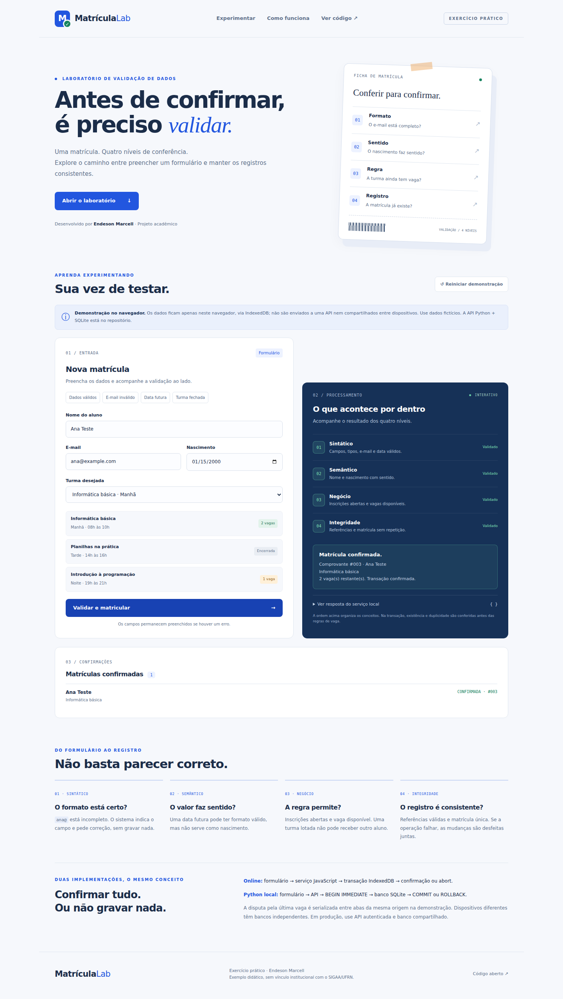
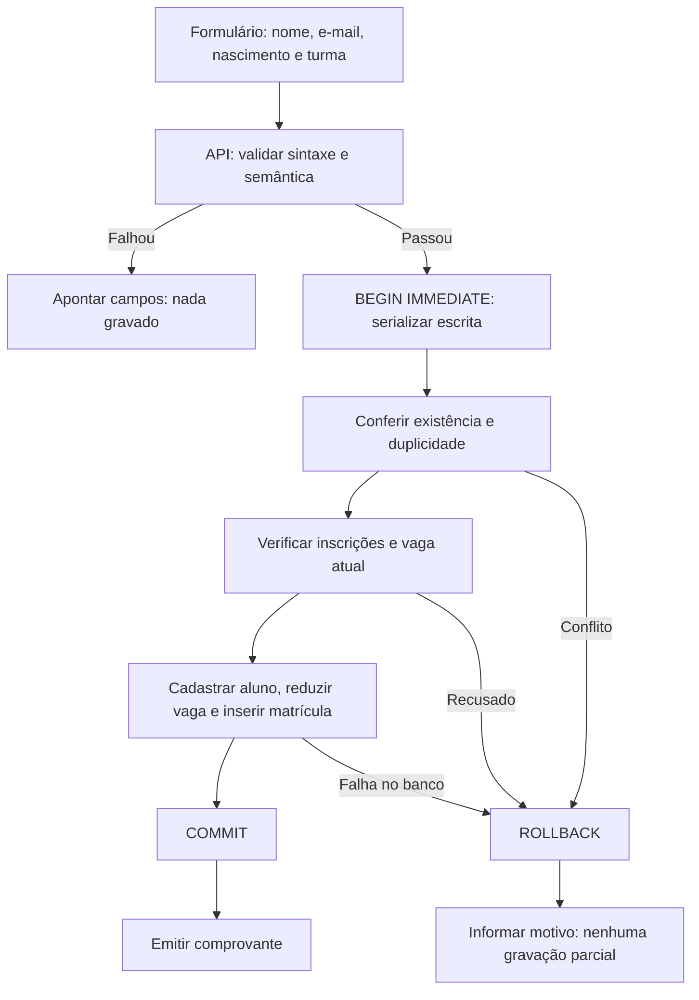

<div align="center">

# Matrícula Lab

### Exercício prático de validação de dados

**Formato, sentido, regra e registro — antes de confirmar uma matrícula.**

[](https://github.com/endeson12/matricula-online-validacao/actions/workflows/tests.yml)


[**Abrir demonstração**](https://matricula-online-validacao.vercel.app) · [Roteiro de apresentação](docs/apresentacao.md) · [Versão Python](python/app.py)

</div>



## Objetivo

Exercício acadêmico desenvolvido por **Endeson Marcell**: implementar validação em quatro níveis, explicar como tratar cada falha e mostrar o pipeline até o banco de dados. O caso de uso é a matrícula online em um curso de informática, inspirado no domínio do SIGAA/UFRN e adaptado didaticamente — sem vínculo institucional, uso de código do SIGAA ou integração com a universidade.

## Duas versões, com limites explícitos

|                  | Demonstração online                           | Implementação local completa                |
| ---------------- | --------------------------------------------- | ------------------------------------------- |
| Interface        | HTML, CSS e JavaScript                        | HTML e JavaScript                           |
| Execução         | Navegador, hospedado na Vercel                | Servidor Python, biblioteca padrão          |
| Persistência     | IndexedDB no navegador                        | Banco SQLite em arquivo                     |
| API HTTP         | **Não há**; serviço JavaScript local          | `GET /api/turmas`, `POST /api/matriculas`   |
| Atomicidade      | Transação `readwrite`, confirmação ou `abort` | `BEGIN IMMEDIATE`, `COMMIT` e `ROLLBACK`    |
| Concorrência     | Serialização entre abas da mesma origem       | Serialização de escritores no SQLite        |
| Compartilhamento | Somente mesmo navegador/perfil/origem         | Clientes que acessam o mesmo servidor/banco |
| Integridade      | Índices únicos e verificações do serviço      | `FOREIGN KEY`, `UNIQUE` e `CHECK` no banco  |

**A Vercel hospeda apenas `public/`.** A demonstração não envia os dados do formulário a um servidor. Outros visitantes têm seus próprios bancos locais. O código Python permanece em `python/` para estudar e demonstrar o fluxo real **formulário → API → banco** exigido pelo exercício. Nenhuma persistência SQLite efêmera em função serverless é apresentada como banco compartilhado.

## O que o professor pediu

| Nível           | Exemplo                                                             | Estratégia de falha                                                   |
| --------------- | ------------------------------------------------------------------- | --------------------------------------------------------------------- |
| **Sintático**   | E-mail `ana@`, campo vazio, tipo incorreto ou data impossível       | Indicar campo e pedir correção, sem gravação.                         |
| **Semântico**   | Nascimento no futuro                                                | Explicar por que o valor não faz sentido, sem gravação.               |
| **Negócio**     | Inscrições encerradas ou turma sem vagas                            | Recusar matrícula e orientar escolha de outra turma.                  |
| **Integridade** | Turma ausente, e-mail com cadastro divergente ou matrícula repetida | Recusar conflito; se a transação começou, desfazer todas as mudanças. |

Os dados preenchidos permanecem no formulário quando ocorre uma falha. Pessoas diferentes podem ter o mesmo nome: duplicidade é por **aluno + turma**, não pelo nome.

## Pipeline real da versão Python



No SQLite o bloqueio de escrita é no banco, não na linha. No PostgreSQL, um desenho equivalente pode usar `SELECT ... FOR UPDATE` sobre a turma. A versão online usa a serialização real de transações IndexedDB que abrangem os mesmos object stores.

## Experimentar online

1. Abra **[Matrícula Lab](https://matricula-online-validacao.vercel.app)**.
2. Use os botões **Dados válidos**, **E-mail inválido**, **Data futura** e **Turma fechada**.
3. Clique em **Validar e matricular** e acompanhe os níveis e a resposta do serviço.
4. Reenvie os mesmos dados para observar a integridade bloquear a duplicidade.
5. Use a turma noturna para testar a última vaga, com alunos fictícios diferentes.
6. **Reiniciar demonstração** pede confirmação antes de remover os dados locais e repor as vagas.

Use apenas dados fictícios, como `ana@example.com`. Os dados sobrevivem ao recarregamento da página, mas podem ser removidos ao limpar o armazenamento do navegador.

## Rodar Python + API + SQLite

Precisa apenas de **Python 3.10+**, sem `pip install`:

```sh
git clone https://github.com/endeson12/matricula-online-validacao.git
cd matricula-online-validacao/python
python app.py
```

No Windows, pode usar `py app.py`; no Linux, `python3 app.py`.

Abra **http://127.0.0.1:8000** e mantenha o terminal aberto. O arquivo `matriculas.db` será criado nessa pasta e não é versionado. Reiniciar o servidor não apaga matrículas.

Para um novo cenário sem apagar o anterior:

```sh
python app.py --db outra_demonstracao.db --port 8001
```

Abra então http://127.0.0.1:8001. Mais detalhes em [docs/versao-python.md](docs/versao-python.md).

## Rodar a interface online localmente

Da raiz do repositório:

```sh
python -m http.server 8080 --directory public
```

Abra **http://127.0.0.1:8080**. Não abra o HTML por duplo clique: módulos JavaScript precisam de servidor HTTP.

## Testes

Da raiz do repositório:

```sh
# 18 testes Python: API, banco, concorrência e rollback
python -m unittest discover -s python -v

# 11 testes de validação JavaScript; requer Node.js 20+
npm test
```

Também existe um QA opcional no Chromium:

```sh
python -m pip install playwright
python -m playwright install chromium
python tests/browser_qa.py
```

O QA verifica os quatro níveis, persistência após recarregar, preservação dos campos, reset confirmado, disputa da última vaga entre abas, rollback real provocado após alterar a vaga, layout móvel e ausência de exceções JavaScript. Ele usa um perfil isolado e dados fictícios.

Os testes Python e JavaScript rodam no GitHub Actions em pushes e pull requests. O QA de navegador é separado e opcional.

## Estrutura

```text
public/                  # Site estático publicado na Vercel
  index.html             # Interface, explicações e pipeline
  style.css              # Layout responsivo
  app.mjs                # Interação e visualização dos resultados
  store.mjs              # Validações e transações IndexedDB
python/
  app.py                 # API, validações e transações SQLite
  index.html             # Formulário da versão com API
  test_app.py            # Testes Python
 tests/
  validation.test.mjs    # Testes unitários JavaScript
  browser_qa.py          # QA opcional de navegador
 docs/                   # Roteiro e capturas da demonstração
.github/workflows/       # Integração contínua
vercel.json              # Publicação estática e cabeçalhos de segurança
```

## Escopo e segurança

Projeto didático, **não um sistema pronto para produção**. Não implementa autenticação, autorização, verificação de propriedade do e-mail ou gestão completa de dados pessoais. A validação de e-mail verifica formato, não se a caixa postal existe. Não há idade mínima inventada. Não use dados pessoais reais e não exponha a API de exemplo como serviço público.

Na demonstração IndexedDB, verificações de referência e vagas são realizadas pelo serviço; o banco não oferece as mesmas constraints SQL de `FOREIGN KEY` e `CHECK`. A versão SQLite demonstra essas constraints efetivamente no banco.

Os recursos do site são locais, sem frameworks ou fontes externas. A hospedagem adiciona CSP, bloqueio de enquadramento e `nosniff`. Arquivos `.env`, bancos locais, caches e configurações privadas da Vercel ficam fora do Git.

## Referências

- [SIGAA/UFRN](https://sigaa.ufrn.br/) — referência de domínio, não implementação copiada.
- [Transações SQLite](https://www.sqlite.org/lang_transaction.html).
- [Bloqueios no PostgreSQL](https://www.postgresql.org/docs/current/explicit-locking.html).
- [Transações IndexedDB — MDN](https://developer.mozilla.org/en-US/docs/Web/API/IDBTransaction).
